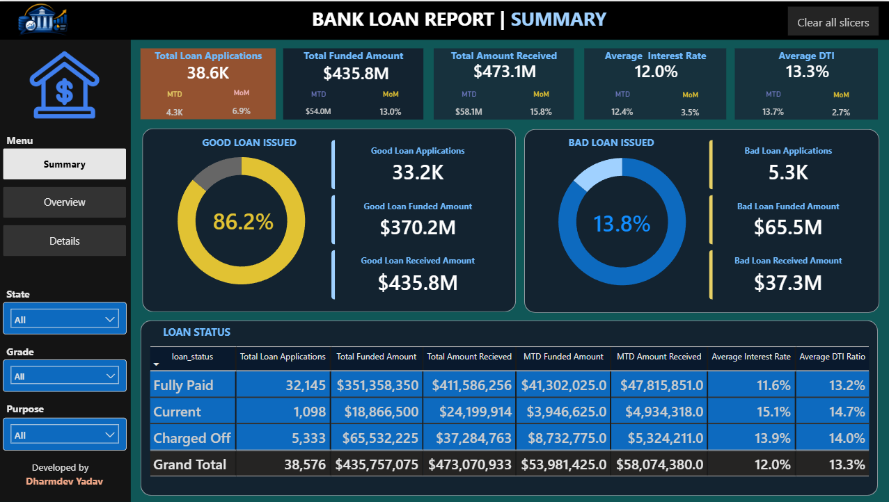
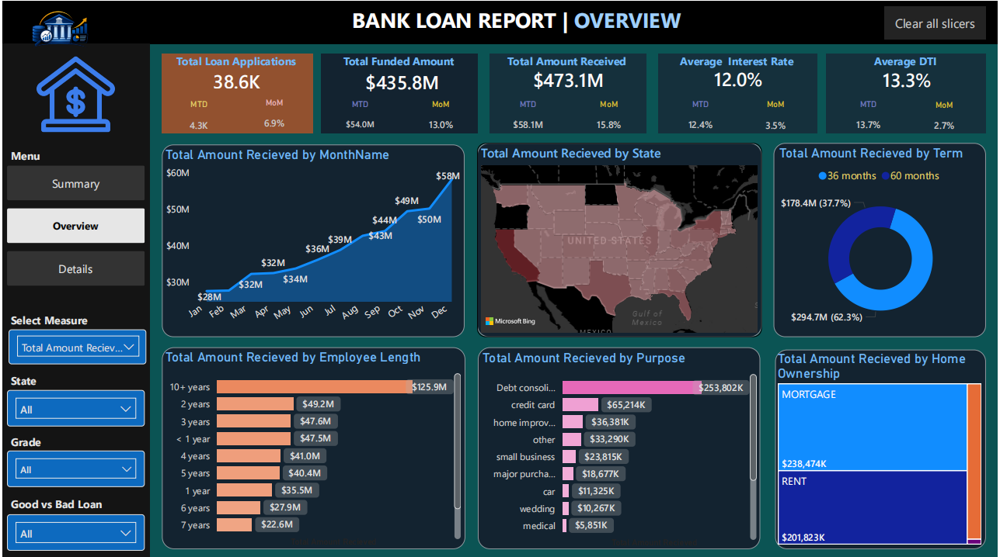
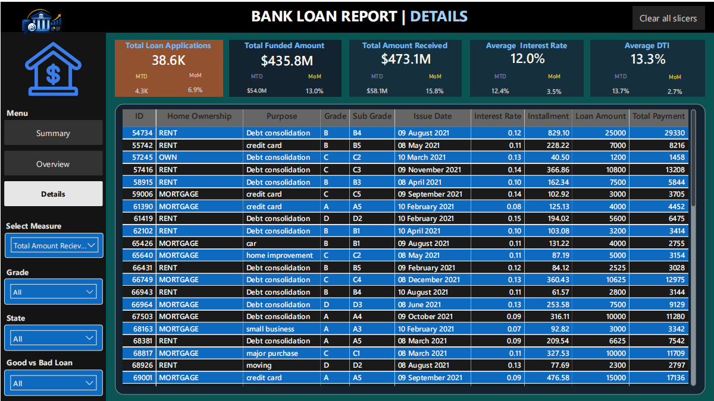

# Bank Loan Analysis | SQL, Python & Power BI

An end-to-end data analytics project exploring bank loan applications, funded amounts, repayments, loan status, and borrower/loan characteristics using **SQL, Python, and Power BI**.

The project demonstrates a data analytics workflow: querying and analysing data with SQL, performing data preparation and exploratory analysis with Python, and communicating findings through an interactive Power BI dashboard.

## Dashboard Showcase

### 1. Summary Dashboard
The summary page highlights the overall loan portfolio, including good vs. bad loan applications, loan status, funded amounts, and received amounts.

### 2. Overview Dashboard
The overview page explores monthly trends, state-wise loan distribution, loan terms, employee length, loan purpose, and home ownership.

### 3. Details Dashboard
The details page provides a loan-level view with fields such as home ownership, purpose, grade, sub-grade, issue date, interest rate, installment, loan amount, and total payment.

## Project Objectives

- Analyse loan applications and loan portfolio performance.
- Compare good loans and bad loans using the project's loan classifications.
- Track funded amounts and amounts received.
- Explore trends by month, state, loan term, purpose, employee length, and home ownership.
- Build an interactive dashboard to support data exploration and reporting.

## Tools & Technologies

| Tool | Project use |
|---|---|
| SQL | Querying, aggregations, filtering, and loan data analysis |
| Python | Data preparation, cleaning, exploratory data analysis (EDA), and visualization |
| Power BI | Data modelling, DAX measures/KPIs, interactive visuals, and dashboard reporting |

## Key Metrics

| Metric | Value |
|---|---:|
| Total Loan Applications | 38.6K |
| Total Funded Amount | $435.8M |
| Total Amount Received | $473.1M |
| Average Interest Rate | 12.0% |
| Average DTI Ratio | 13.3% |
| Good Loan Applications | 86.2% |
| Bad Loan Applications | 13.8% |

*Figures are taken from the dashboard screenshots. Values may be rounded as displayed in Power BI.*

## Dashboard Pages & Analysis

### Summary
- Good Loan vs. Bad Loan application split.
- Loan applications by loan status: Fully Paid, Current, and Charged Off.
- Funded amount and received amount comparisons.
- Key portfolio KPIs.

### Overview
- Monthly trend of total amount received.
- State-wise loan distribution.
- Comparison of 36-month and 60-month loan terms.
- Analysis by employee length, loan purpose, and home ownership.

### Details
- Detailed loan-level records.
- Loan grade and sub-grade.
- Interest rate, installment, loan amount, and total payment.
- Interactive slicers for exploring the data.

## Skills Demonstrated

- SQL-based data analysis
- Python data preparation and exploratory data analysis
- Power BI dashboard development
- DAX and KPI reporting
- Data visualisation and business-focused storytelling
- Translating analytical questions into report pages

## Notes

- This is an analytical portfolio project. The classifications and findings are based on the dataset used for the analysis.
- Good Loan and Bad Loan are the categories defined for this project; they should not be interpreted as an independent credit-risk assessment.
- Please ensure that any dataset shared publicly does not contain confidential or personally identifiable information.

## Author

Dharmdev Yadav

Aspiring Data Analyst | SQL | Python | Power BI

